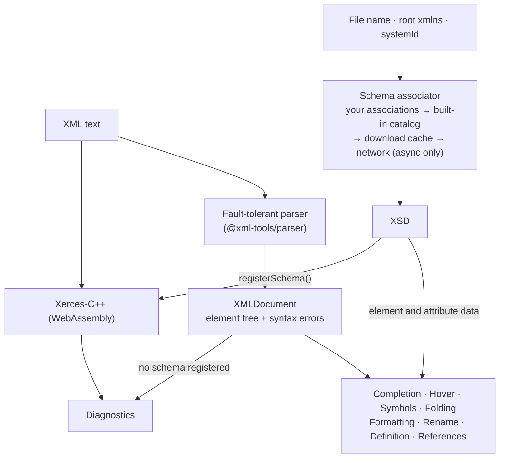

<h1 align="center">XML Language Service</h1>

<p align="center"><strong>Editor features and XSD validation for XML, in JavaScript and TypeScript. No Java, no native install.</strong></p>

<p align="center">
  <a href="https://www.npmjs.com/package/xml-language-service">
    
  </a>
  <a href="https://www.npmjs.com/package/xml-language-service">
    
  </a>
  <a href="https://github.com/harshanacz/xml-language-service/actions/workflows/ci.yml">
    
  </a>
  <a href="https://github.com/harshanacz/xml-language-service/blob/main/LICENSE.md">
    
  </a>
  
</p>

`xml-language-service` gives you the building blocks of an XML editor (completion, hover, outline, folding, formatting, rename, go to definition, references and validation) as plain functions that return plain objects. Use it in a language server, an editor plugin, a CLI, a web app or a test suite.

- **Works on broken XML.** The parser is fault-tolerant, so half-typed documents still produce a usable tree.
- **Real XSD validation.** Schemas are checked by Apache Xerces-C++ compiled to WebAssembly and shipped inside the package.
- **Knows common files.** `pom.xml`, `web.xml`, `persistence.xml` and Spring bean files get schema-aware completion out of the box.

Documentation site: **https://harshanacz.github.io/xml-language-service/**

## Contents

- [Install](#install)
- [Quick start](#quick-start)
- [Features](#features)
- [How it works](#how-it-works)
- [Validation](#validation)
- [Schemas](#schemas)
- [API reference](#api-reference)
- [Debugging the parser output](#debugging-the-parser-output)
- [Projects using it](#projects-using-it)
- [Development](#development)

## Install

```bash
npm install xml-language-service
```

- Node.js 18 or newer
- ESM only (`import`, not `require`)

The Xerces WebAssembly file is included in the package, so there is nothing else to install.

## Quick start

```typescript
import { getLanguageService } from "xml-language-service";

const service = getLanguageService();

const xml = `<catalog>
  <book id="bk101">
    <title>XML Developer Guide</title>
  </book>
</catalog>`;

const document = service.parseXMLDocument("file:///catalog.xml", xml);

service.doComplete(document, { line: 1, character: 4 }); // { items: [catalog, book, title] }
service.doHover(document, { line: 2, character: 6 });    // markdown for <title>
service.findDocumentSymbols(document);                     // catalog > book (bk101)
service.getFoldingRanges(document);                        // lines 0-4 and 1-3

await service.dispose();
```

Positions are zero-based `{ line, character }`, the same as the Language Server Protocol.

## Features

| Feature | What it does |
| --- | --- |
| Parsing | Builds an element tree even when the XML is incomplete or malformed. |
| Completion | Suggests element names, attributes and closing tags. Uses the schema when one is associated. |
| Hover | Shows an element's attributes and children, or its schema documentation when a schema is associated. |
| Document symbols | Builds a nested outline for sidebars and breadcrumbs. |
| Folding | Finds multi-line elements and comments that can be collapsed. |
| Formatting | Re-indents the document and keeps its line endings. |
| Rename | Renames an opening tag and its matching closing tag together. |
| Definition | Jumps between an opening tag and its closing tag. |
| References | Finds every element with the same tag name. |
| Validation | Reports syntax errors (including mismatched tags and undefined entities) and XSD errors. |
| Printers | Prints the parsed tree as text or JSON for debugging and snapshot tests. |

## How it works



- Every feature works from the parsed `XMLDocument`. A schema is optional and only adds information.
- Validation with a schema runs Xerces over the raw text in one streaming pass, so errors before a fatal syntax error are still reported.
- Without a schema, `validate()` returns the parser's own syntax errors.

## Validation

### Without a schema

`validate()` still checks that the document is well-formed when no schema is registered under the given URI:

```typescript
const document = service.parseXMLDocument("file:///a.xml", "<a><b></a>");
const diagnostics = await service.validate("file:///a.xml", document);
// [{ message: "expected end of tag 'b' but found 'a'", severity: "error", source: "syntax", range: ... }, ...]
```

### With an XSD

Register the schema once, then validate any number of documents against it:

```typescript
await service.registerSchema({
  uri: "file:///catalog.xsd",
  xsdText: catalogXsd,
});

const document = service.parseXMLDocument("file:///catalog.xml", xmlText);
const diagnostics = await service.validate("file:///catalog.xsd", document);
```

Each diagnostic looks like this:

```typescript
{
  range: { start: { line, character }, end: { line, character } },
  message: string,
  severity: "error" | "warning" | "info",
  source: "xsd" | "syntax",
}
```

### Schemas split across files

If the root XSD uses `xs:include` or `xs:import`, pass the other files in `imports`. The keys must match the `schemaLocation` values used in the XSD.

```typescript
await service.registerSchema({
  uri: "file:///root.xsd",
  xsdText: rootXsd,
  imports: {
    "types.xsd": typesXsd,
    "common.xsd": commonXsd,
  },
});
```

## Schemas

Completion and hover look up a schema for the document when you pass its `fileName` (and optionally its full `documentPath`). The lookup order is:

1. Your associations, added with `addUserAssociation()`
2. The built-in catalog, matched by file name or the root element's `xmlns`
3. With `resolveSchemaForDocumentAsync()` and a `systemId` URL only: the download cache, then the network

### Built-in schemas

| File | Namespace | Schema |
| --- | --- | --- |
| `pom.xml` | `http://maven.apache.org/POM/4.0.0` | Maven 4.0.0 |
| `web.xml` | `http://xmlns.jcp.org/xml/ns/javaee` | Java Servlet 3.1 |
| `persistence.xml` | `http://xmlns.jcp.org/xml/ns/persistence` | JPA 2.2 |
| `spring-*.xml` | `http://www.springframework.org/schema/beans` | Spring Beans 4.3 |

The list lives in [`resources/schemas/catalog.json`](resources/schemas/catalog.json). See [`resources/schemas/README.md`](resources/schemas/README.md) for where each schema comes from and how to add one.

```typescript
const pom = service.parseXMLDocument("file:///project/pom.xml", text);
service.doComplete(pom, position, "pom.xml"); // modelVersion, parent, groupId, ...
```

### Your own associations

```typescript
service.addUserAssociation({
  pattern: "**/*.config.xml",
  xsdPath: "/absolute/path/to/config.xsd",
  isBuiltIn: false,
});

service.resolveSchemaForDocument("app.config.xml");
// { xsdText, xsdPath, source: "custom" }
```

Your associations take priority over the built-in catalog. The one exception is `pom.xml`, which always uses the bundled Maven schema.

### Remote schemas

`resolveSchemaForDocumentAsync()` can fetch a schema that is not available locally. When `systemId` is an `http://` or `https://` URL, the XSD is downloaded once and cached in `.cache/xml-schemas/` under the current working directory.

```typescript
const schema = await service.resolveSchemaForDocumentAsync(
  "config.xml",
  undefined,
  undefined,
  "https://example.com/schemas/config.xsd",
);
// schema?.source is "network" the first time and "cache" afterwards
```

Only the root XSD is downloaded. Files it pulls in with `xs:include` or `xs:import` are not.

## API reference

Create a service with `getLanguageService()`. It holds compiled schemas, so call `dispose()` when you are done.

**Editor features**

| Method | Returns |
| --- | --- |
| `parseXMLDocument(uri, text)` | `XMLDocument` |
| `doComplete(document, position, fileName?, documentPath?)` | `CompletionList` |
| `doHover(document, position, fileName?, documentPath?)` | `HoverResult \| null` |
| `findDocumentSymbols(document)` | `DocumentSymbol[]` |
| `getFoldingRanges(document)` | `FoldingRange[]` |
| `format(document, { tabSize?, insertSpaces? }?)` | `TextEdit[]` |
| `doRename(document, position, newName)` | `TextEdit[] \| null` |
| `doDefinition(document, position)` | `DefinitionResult \| null` |
| `findReferences(document, position)` | `ReferenceResult[]` |

**Validation and schemas**

| Method | Returns |
| --- | --- |
| `registerSchema({ uri, xsdText, xsdPath?, imports? })` | `Promise<void>` |
| `validate(schemaUri, document)` | `Promise<Diagnostic[]>` |
| `hasSchema(uri)` | `boolean` |
| `resolveSchemaForDocument(fileName, xmlns?, documentPath?)` | `ResolvedSchema \| null` |
| `resolveSchemaForDocumentAsync(fileName, xmlns?, documentPath?, systemId?)` | `Promise<ResolvedSchema \| null>` |
| `addUserAssociation(association)` | `void` |
| `clearUserAssociations()` | `void` |
| `invalidateAutoSchemas()` | `Promise<void>`. Drops schemas registered under `auto://` URIs so they are reloaded. |
| `dispose()` | `Promise<void>` |

**Debugging**

| Method | Returns |
| --- | --- |
| `printTreeAST(document)` | `string` |
| `printAST(document, options?)` | `string` |
| `printCST(document, options?)` | `string` |

All result types (`XMLDocument`, `Position`, `Range`, `Diagnostic`, `CompletionItem`, `HoverResult`, `DocumentSymbol`, `FoldingRange`, `TextEdit` and more) are exported from the package.

## Debugging the parser output

```typescript
const document = service.parseXMLDocument(
  "file:///catalog.xml",
  `<catalog><book id="bk101"/></catalog>`,
);

console.log(service.printTreeAST(document));
// Document
// └── catalog
//     └── book

console.log(service.printAST(document));
// Document
//   Element <catalog>
//     Element <book>
//       Attribute id="bk101"

console.log(service.printAST(document, { format: "json", includePositions: true }));
console.log(service.printCST(document)); // every grammar rule and token from the parser
```

| Option (`printAST`, `printCST`) | Type | Default |
| --- | --- | --- |
| `format` | `"tree" \| "json"` | `"tree"` |
| `indent` | `number` | `2` |
| `includePositions` | `boolean` | `false` |
| `includeTokens` | `boolean` | `true` |

To try all three printers on a sample document:

```bash
npm run build
node tests/utils/manual.mjs
```

## Projects using it

- [xml-language-server](https://github.com/harshanacz/xml-language-server): a Language Server Protocol server built on this package
- [xml-language-client](https://github.com/harshanacz/xml-language-client): the VS Code extension for that server
- [xml-review-bot-demo](https://github.com/harshanacz/xml-review-bot-demo): a demo XML review bot

## Development

```bash
npm install
npm run build      # compile TypeScript and copy the schemas into dist/
npm run test:run   # run the test suite once
npm test           # run the tests in watch mode
```

CI runs the tests on Windows, macOS and Linux with Node.js 20, 22 and 24.

Found a bug or want a feature? [Open an issue](https://github.com/harshanacz/xml-language-service/issues).

## License

[MIT](LICENSE.md)
